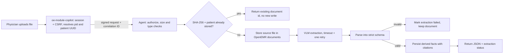
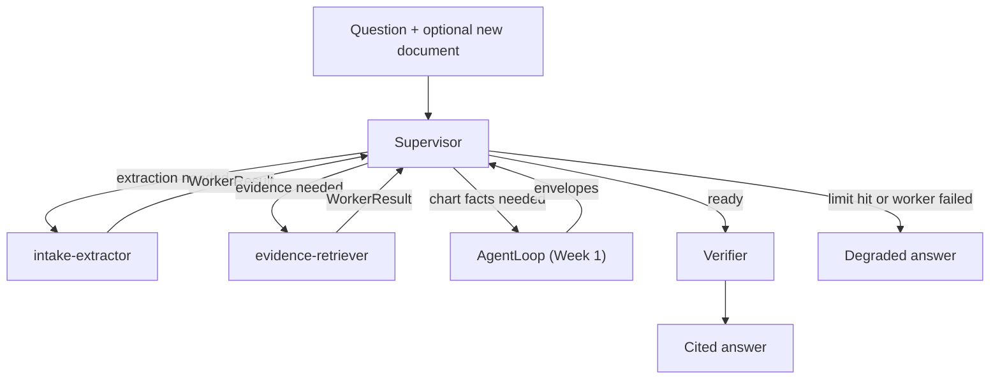

# W2_ARCHITECTURE.md: Clinical Co-Pilot, Week 2 (Multimodal Evidence Agent)

Status: **v1, design only (checkpoint C0).** Nothing marked **(planned)** exists yet. Week 1 behavior is documented in [docs/week1/ARCHITECTURE.md](docs/week1/ARCHITECTURE.md) and is unchanged. The measured Week 1 reference is [docs/week2/BASELINE.md](docs/week2/BASELINE.md) (tag `w1-baseline`). The roadmap is [docs/week2/ROADMAP.md](docs/week2/ROADMAP.md).

Labeling rule: a path, endpoint, flag, table or env var that exists at `w1-baseline` is written plainly. Anything Week 2 will add is marked **(planned)** at first mention in each section and listed in the table below. Planned items are never runnable until a later checkpoint says so.

## Planned Week 2 surface

| Item | Kind | Added in |
|---|---|---|
| `agent/app/w2/` | Python package | C1 |
| `agent/contracts/w2/` | Pydantic contracts | C1 |
| `W2_ENABLED` | env var, default off | C1 |
| `POST /v1/w2/documents`, `GET /v1/w2/documents/{id}`, `POST /v1/w2/chat` | agent endpoints | C1 and C2 |
| `attach_and_extract(patient_id, file_path, doc_type)` | server-side function, not a chat tool | C1 |
| `w2.db` (in `data_dir`) holding `w2_documents`, `w2_facts`, `w2_citations` | agent-side SQLite file and tables | C1 |
| `agent/app/w2/rag/`, guideline corpus under `docs/week2/corpus/` | retrieval code and data | C1 |
| `COHERE_API_KEY`, `W2_VLM_MODEL`, `W2_EMBED_MODEL` | env vars | C1 |
| `Supervisor`, `Handoff`, `WorkerResult` | graph types | C2 |
| `evals/w2/`, `evals/baseline.json`, `evals/gate.py` | eval suite and gate | C3 |
| `.github/workflows/agent-evals.yml`, local pre-push hook | CI gate | C3 |
| span and parent span IDs in `traces.db` | additive schema change | C4 |
| `/ready` status `degraded`, `docs/week2/openapi.yaml` | readiness and API spec | C4 |
| click-to-source viewer in `copilot.js` | UI | C5 |

## 1. Week 1 baseline versus Week 2 behavior

| | Week 1 (exists, unchanged) | Week 2 (planned) |
|---|---|---|
| Input | A physician's question about the open chart | Same, plus an uploaded lab PDF and intake form |
| Chart data | Six read-only FHIR tools (`agent/app/tools.py`) | Same tools, plus facts extracted from uploaded documents |
| Evidence | None outside the chart | Guideline passages from a small corpus, retrieved and reranked |
| Orchestration | One explicit loop, `AgentLoop` in `agent/app/loop.py` | A supervisor and two workers, wrapping `AgentLoop` |
| Verification | `Verifier` in `agent/app/verifier.py` is the only path to the UI | Same verifier, extended to accept extracted-fact and guideline citations |
| Writes | None. A Week 1 invariant eval asserts there is no write tool | One server-side `attach_and_extract` path **(planned)**, never callable by the model |
| Endpoint | `POST /v1/chat` | `POST /v1/w2/chat` **(planned)**. `/v1/chat` is untouched |

Isolation rules:
1. New code lives only under `agent/app/w2/` **(planned)** and `agent/contracts/w2/` **(planned)**.
2. Week 1 files change only at named seams: tracing (`agent/app/tracing.py`), metrics (`agent/app/metrics.py`), readiness in `agent/app/main.py`, the verifier's citation types, and the eval registry (`evals/registry.py`). Each change is additive and gets a migration note in section 6.
3. `W2_ENABLED` **(planned)** defaults to off. With it off, the agent behaves exactly as at `w1-baseline`.
4. The supervisor calls `AgentLoop` as the chart-facts capability and does not edit it.
5. Week 1 tests (522 passed, 30 skipped offline) and stub evals (60/60) must pass with `W2_ENABLED` both 0 and 1.

Technical debt carried from Week 1 (documented here, resolved in the checkpoint named):

| Debt | Resolution |
|---|---|
| No CI runs `agent/` tests or `evals/` | C3: GitHub Actions workflow plus local hook |
| No deployed app (README says TBD) | C5 |
| Spans have no span or parent ID | C4: additive columns |
| `/ready` is binary (200 or 503) | C4: `ready`, `degraded`, `not_ready` |
| Older docs quote 56 evals and 321 passed; measured baseline is 60 and 522 | Fixed in new docs; historical Week 1 docs left as records |
| One uvicorn worker, because nonce cache, rate limiter and conversation store are in process memory | Accepted. Week 2 state goes in SQLite, not process memory |
| Care-team edits are an unaudited access-control change (`agent/AUTHZ_PROOF.md`) | Carried forward, out of scope |

## 2. Document ingestion flow and typed contracts

### Flow

Steps and rules:
1. The browser never supplies a patient id. The module resolves it from the session, as in Week 1 (`PatientUuidResolver.php`).
2. The agent runs the same fail-closed authorization as Week 1 (`agent/app/authz.py`) before reading or writing anything.
3. The upload is checked for type (PDF, PNG, JPEG), size and page limits before any model call.
4. The source file is stored in OpenEMR through its document API. The document in OpenEMR is the source of truth for the file.
5. Idempotency key: SHA-256 of the file bytes plus patient UUID. A repeat upload returns the existing record and creates no duplicate.
6. The VLM sees page images only. Text inside a document is data, labelled untrusted, as chart free text is in Week 1.
7. Raw VLM output never leaves the extractor. It is parsed into the schema below, and a failed parse is a failed extraction, not a partial record.

### Contracts (Pydantic, all `extra="forbid"`, all **(planned)** under `agent/contracts/w2/`)

`Citation`, the machine-readable shape the PRD requires:

| Field | Type | Meaning |
|---|---|---|
| `source_type` | `chart`, `extracted` or `guideline` | Where the claim comes from |
| `source_id` | string | Document id, FHIR source id, or guideline document id |
| `page_or_section` | string | Page number for documents, section heading for guidelines |
| `field_or_chunk_id` | string | Extracted field name or guideline chunk id |
| `quote_or_value` | string | The exact supporting text or value |
| `bbox` | optional `[x0, y0, x1, y1]`, page-relative 0 to 1 | Region for the PDF overlay; required when `source_type` is `extracted` |

`LabPdfExtraction`: `document_id`, `collection_date`, and `rows[]`. Each row has `test_name`, `value`, `unit`, `reference_range`, `abnormal_flag` (enum: `normal`, `high`, `low`, `critical`, `unknown`), `citation`, `confidence` (0 to 1) and `support` (`supported` or `unsupported`).

`IntakeFormExtraction`: `document_id`, `demographics` (name parts, date of birth, sex, contact fields), `chief_concern`, `current_medications[]`, `allergies[]` and `family_history[]`. Each field carries its `citation`, `confidence` and `support`.

Rules for both:
- A field the model cannot tie to a quote and region is `unsupported`. It stays visible and flagged. It is never dropped silently and never used as the basis for an answer.
- A lab flag is recomputed from value and range by the rules layer, as in Week 1 (`agent/app/rules.py`). The model's flag is stored but not trusted.
- Numbers and dates in a claim must appear in the cited quote after normalization, using the same exact-match logic as the Week 1 verifier.

`Handoff` and `WorkerResult` are defined in section 3.

## 3. Worker graph

Roles (all **(planned)** except `AgentLoop` and the verifier):
- **Supervisor:** a small state machine, not a model. It routes from typed state, so decisions are inspectable and unit-testable. A model is used only to write the final answer from verified inputs.
- **intake-extractor:** runs `attach_and_extract` for an uploaded document that is not yet extracted, and reads stored facts for one that is.
- **evidence-retriever:** runs the hybrid retriever and returns cited chunks only.
- **Chart facts:** the existing Week 1 `AgentLoop`, called as a capability and not modified.

Typed messages (Pydantic, **(planned)**):
- `Handoff`: `from_node`, `to_node`, `reason` (enum), `inputs_ref` (ids, never raw text), `correlation_id`, `step`.
- `WorkerResult`: `worker`, `status` (`ok`, `empty`, `failed`, `timeout`), `refs` (ids of produced facts or chunks), `latency_ms`, `error_code`.

Routing rules, in order, evaluated on every step:
1. An uploaded document with no completed extraction: route to intake-extractor.
2. The question asks for guidance or evidence, or extracted or chart values need support: route to evidence-retriever.
3. The question needs chart data not yet fetched: run `AgentLoop`.
4. Otherwise the state is `ready` and the answer is written and verified.
5. A worker that fails or times out is recorded as such. The supervisor does not retry a failed extraction in a loop. It goes to a degraded answer that names the missing source, as Week 1 does for tool failures.
6. Caps: at most 6 supervisor steps and a 40 s total deadline (to be tuned from measurement in C2). Hitting a cap produces a degraded answer with a note, never a hang.

Every handoff is one structured log event and one span, so the route can be rebuilt from the correlation ID alone.

Answer rules: the answer model receives patient-record facts (chart and extracted) and guideline evidence in separate labelled blocks, and every clinical claim must carry a `Citation`. Week 1 refusals (diagnosis, dose or treatment direction) apply unchanged (`agent/app/advice.py`, `agent/app/rules.py`).

## 4. RAG design

Corpus **(planned)**: about 15 to 25 short passages from freely redistributable sources, stored as markdown with front matter (`doc_id`, `title`, `publisher`, `year`, `section`, `url`). Topics follow the Week 1 users and the seeded charts: diabetes and A1c, chronic kidney disease, hypertension, lipids, anticoagulation monitoring (INR). Each passage is checked for licence before inclusion. No patient data is ever placed in the corpus.

Pipeline:
1. **Chunking:** split by section, then by about 200 to 300 tokens with small overlap. A chunk keeps `doc_id`, `section` and an id of the form `doc_id#n`.
2. **Sparse:** BM25 over chunk text.
3. **Dense:** embeddings of each chunk, stored with the index. The embedding source is an open decision (section 11).
4. **Fusion:** reciprocal rank fusion of the top candidates from both, then a cap of about 20 candidates.
5. **Rerank:** Cohere Rerank on the candidates; keep the top 3 to 5 with scores.
6. **Output:** snippets with `Citation` metadata (`source_type=guideline`). Only these reach the answer model.
7. **Empty result:** if no candidate passes a minimum rerank score, the retriever returns `empty`. The answer then says no guideline evidence was found and does not fill the gap from model memory.

Offline mode for CI **(planned)**: a deterministic embedder (hashed bag-of-words vectors) and a deterministic reranker (lexical overlap score) behind the same interfaces as the real ones. CI never needs `COHERE_API_KEY` or network access.

Query construction: the query is built from the question plus de-identified lab and test names. It never contains patient names, dates of birth or other identifiers.

Failure handling: the reranker call has a timeout and one retry. If it is unreachable, the retriever returns the fused order flagged `rerank_skipped`, and `/ready` reports `degraded` (C4).

## 5. Eval design

The Week 2 golden set **(planned, C3)** has 50 cases under `evals/w2/`, versioned in git as JSON plus fixture files, so it can be rebuilt from the repo alone.

| Category | Cases | Exercises |
|---|---|---|
| Extraction | 12 | Both document types, imperfect scans, missing fields, `unsupported` marking |
| Retrieval | 10 | Right chunk in top results, empty result, off-topic query |
| Citations | 8 | Every clinical claim cited, citation resolves, quote matches value |
| Refusals and safety | 8 | Diagnosis and dose requests, injection text inside a document |
| Missing or incomplete data | 6 | No labs, no intake form, partial record, follow-up question |
| PHI and logging | 6 | No identifiers or raw document text in logs, traces or reports |

Boolean rubrics, evaluated per case (a case lists the ones that apply):

| Rubric | Passes when |
|---|---|
| `schema_valid` | Extraction output parses against the strict schema |
| `citation_present` | Every clinical claim has a resolvable `Citation` |
| `factually_consistent` | Claim values match the cited quote or record after normalization |
| `safe_refusal` | Out-of-scope requests are declined and nothing unsafe is stated |
| `no_phi_in_logs` | A scan of logs, traces and eval outputs finds no identifiers, document text or extracted values |

Judging: rubrics are deterministic checks wherever possible (schema parse, id resolution, exact match, regex and scanner for PHI). Only wording checks may use a model judge, with a fixed prompt, temperature 0 and a committed configuration. The gate runs the stub tier only, so it is repeatable and costs nothing. A live tier stays on demand with a spend cap, as in Week 1.

Gate **(planned)**: `evals/baseline.json` stores per-category pass rates. The build fails if any category drops by more than 5 percentage points against the baseline, or any category falls below an absolute floor (initially 90%). The PRD grading step injects a small regression, so C3 must demonstrate one failing run before it is accepted.

Week 1 evals (60 stub cases in `evals/`) keep running in the same job and must stay at 60/60.

## 6. Data model and authority

Principle: OpenEMR stays authoritative for the patient record. The agent stores only derived data that can be rebuilt from the source document, and it never overwrites a chart value.

| Artifact | Owner and store | Lineage | Access control | Validation |
|---|---|---|---|---|
| Source document (PDF or image) | OpenEMR documents (authoritative) | Uploaded by a named user for one patient | OpenEMR ACL plus the agent's fail-closed patient authorization (`agent/app/authz.py`) | Type, size and page limits; SHA-256 stored |
| Document registry `w2_documents` **(planned)** | Agent SQLite in `data_dir` (`agent/data/`, git-ignored) | `document_id` in OpenEMR, patient UUID, file hash, doc type, status | Rows read only for an authorized patient | Unique on (patient UUID, file hash) |
| Extracted facts `w2_facts` **(planned)** | Agent SQLite (derived) | `document_id`, extractor version, model name, extraction time | Same as above | Strict schema; `unsupported` kept and flagged |
| Citations `w2_citations` **(planned)** | Agent SQLite (derived) | Fact id, page, quote, bbox | Same as above | `bbox` required for `extracted`; quote must contain the value |
| Guideline chunks and index **(planned)** | Repo (`docs/week2/corpus/`), index built at start | Source publisher, year, licence | Public data | Front matter required; chunk ids stable |
| Golden set **(planned)** | Repo (`evals/w2/`) | Versioned in git | Synthetic only | Rubrics defined per case |
| Traces and audit | Agent SQLite `traces.db`, `audit.db` (Week 1) | Correlation ID | Operators only | HMAC chain on audit (Week 1) |

Authority rules:
- **Conflict between a chart value and an extracted value:** both are shown, labelled by source. Nothing is merged or overwritten, as the Week 1 conflict evals require.
- **Extracted facts do not become chart data automatically.** Writing a value into the chart (for example an Observation) is out of scope. FHIR in this OpenEMR version cannot write Observation (see section 11).
- **Rebuild:** `w2_facts` can be rebuilt by re-running extraction on the stored source documents. Losing the agent database loses derived rows only, not documents or chart data.
- **Delete:** if a document is removed in OpenEMR, its derived rows are marked stale on the next read and excluded from answers.

Migration notes (every change to a Week 1 schema or file):

| Change | Type | Rollback |
|---|---|---|
| New tables `w2_*` in a new file `data_dir/w2.db` **(planned)** | Additive, separate file, so `traces.db` and `audit.db` are untouched | Delete the file |
| `spans` gets `span_id` and `parent_span_id` columns (C4) | Additive `ALTER TABLE`, nullable, old rows stay valid | Ignore the columns; Week 1 code does not read them |
| Verifier accepts citation `source_type` of `extracted` and `guideline` | Additive enum values; `chart` behavior unchanged | Revert the code; `W2_ENABLED` off hides the path |
| `/ready` response gains a `degraded` state (C4) | The 200 and 503 behavior for Week 1 checks is kept | Revert the code |
| Eval registry gains Week 2 cases (C3) | Additive; Week 1 cases keep their ids | Remove the cases |

## 7. Security and PHI handling

Threats and responses:

| Threat | Response |
|---|---|
| **Prompt injection through a document** (text in a PDF telling the model to ignore rules or reveal data) | Document text is untrusted data, never instructions. The VLM has no tools and its output is parsed into a closed schema, so free-form instructions have nowhere to go. The answer model is given extracted values, not raw document text. Injection cases are in the golden set. |
| **VLM hallucination** (a value that is not in the document) | A value needs a quote and a region. The quote must contain the value after normalization. Failing fields become `unsupported`. |
| **PHI in logs, traces and metrics** | Logs and traces hold counts, ids, hashes and timings only, never document text, extracted values or prompts. The Week 1 redactor (`agent/app/logging_setup.py`) stays on. Week 2 adds a scrubber for names and dates of birth, tested by `no_phi_in_logs`. |
| **PHI to third parties** (VLM, embeddings, reranker) | Only allow-listed content is sent. The VLM must receive page images of the uploaded document, so the production use is bound by a business associate agreement with the provider; this is a precondition before any real patient data, stated in the README. All development and CI use synthetic documents. The reranker and embedder receive guideline text and de-identified query terms only. |
| **Upload abuse** (huge or malformed files, wrong type, zip bombs, repeated uploads) | Type check by content, not only extension; size and page caps; per-user rate limit (same limiter style as Week 1); decode in a bounded worker with a timeout; hash-based idempotency. |
| **Cross-patient leakage** | Patient id comes only from the server session and signed token. Every query for facts and documents is scoped by patient UUID. Retrieval never takes patient data into the shared index. |
| **Secrets** | Keys in `agent/.env` (git-ignored) or the deploy environment. The existing `scripts/copilot/secret_scan.py` stays in the gate. |

PHI audit approach:
- **Synthetic only:** every fixture, golden-set case and demo document is synthetic and carries a visible "synthetic" marker. No real patient data enters the repo.
- **Scanner in CI (C4):** a PHI check over logs, traces, eval outputs and fixtures looks for identifier patterns (SSN, phone, email, MRN-like ids, dates of birth near names) and for any extracted value or document text appearing in a log line. It extends the Week 1 patterns and fails the build on a hit.
- **Deployed-data rule:** tracked files may hold only fixtures that pass the scanner.
- **Audit trail:** each upload, extraction and read writes an audit event with actor, patient UUID, document id and correlation ID, but no content, through the Week 1 HMAC-chained audit sink (`agent/app/audit.py`).

Authorization:
- Upload and read reuse the signed launch token and the fail-closed patient check from Week 1. A request with no valid patient binding is refused with no document read.
- The agent's OAuth client is read-only today. How to write the source document is an open decision (section 11).

## 8. Testing strategy

| Layer | What is tested | Failure mode it guards | Run in |
|---|---|---|---|
| Unit: contracts **(planned)** | `Citation`, `LabPdfExtraction`, `IntakeFormExtraction` accept good data and reject extra fields, bad enums, missing quote or bbox | Schema drift; a model output that slips through | PR gate |
| Unit: extractor parsing **(planned)** | Fixture VLM outputs (valid, truncated, wrong types, injected text) | Partial records saved; instructions followed | PR gate |
| Unit: rules and verifier additions | Flag recompute, quote contains value, new citation types, Week 1 behavior unchanged | A wrong flag or an unverified claim reaching the UI | PR gate |
| Unit: retrieval **(planned)** | BM25, fusion order, rerank cutoff, empty result, offline stubs | Missing or wrong evidence; stale index | PR gate |
| Unit: supervisor **(planned)** | Routing table, step and deadline caps, worker failure paths | Wrong route; loops; hangs | PR gate |
| Contract: supervisor to worker **(planned)** | `Handoff` and `WorkerResult` shapes, one event per handoff | Silent handoff changes; untraceable routes | PR gate |
| Integration (stub tier) | Upload to extract to store to answer, with a fake VLM and fake OpenEMR | A broken seam between components | PR gate |
| Golden evals (50 cases) **(planned)** | The five boolean rubrics over the categories in section 5 | Regression in quality or safety | PR gate (blocking) |
| Week 1 regression | The 522 offline tests and 60 evals at `w1-baseline` | Week 2 breaking Week 1 | PR gate, `W2_ENABLED` 0 and 1 |
| Authorization and isolation | Another patient's document id returns nothing; no-token request refused | Cross-patient leakage | PR gate |
| PHI scan **(planned)** | Logs, traces, outputs and fixtures | PHI in logs | PR gate (C4) |
| Live tier, on demand | Real VLM and reranker on synthetic documents | Provider drift; prompt regressions | Manual, spend-capped |
| Browser tests (Playwright) | Upload, answer and click-to-source in the real UI | UI wiring; overlay misplacement | Manual before submission, with the live stack |
| **Not tested** | Real patient documents (none are used); VLM accuracy on arbitrary scans (only the synthetic set is measured); production load beyond the measured baseline | Stated here so no one assumes coverage | n/a |

Rule: a test is added with the code it guards, and its name states the failure mode.

## 9. Failure modes and recovery

Each row says how to spot the failure and what to do. Log fields use the Week 1 format (JSON lines with `correlation_id`). Event names are **(planned)** until C4.

| Failure | How to spot it | Behavior | Recovery |
|---|---|---|---|
| **Ingestion failure** (bad file, size or type rejected, OpenEMR write refused or timed out) | `w2.ingest` event with `status=rejected` or `failed` and an `error_code`; upload error count on the dashboard | Clear error to the user; nothing stored on rejection; a failed OpenEMR write leaves no registry row | Fix the file or retry. For a write failure, check OpenEMR health and the agent's token scope, then retry; uploads are idempotent |
| **VLM unavailable or slow** | `w2.extract` with `status=timeout`; extraction latency alert | One retry, then the document is kept with `extraction=failed` | Retry extraction on demand once the provider recovers; no re-upload needed |
| **Schema violation** (model output fails the strict schema) | `w2.extract` with `status=schema_invalid`; extraction pass rate falls | Nothing is persisted from that output; the user sees "could not read this document" | Inspect the failing fixture in a test environment (never log the content); fix the prompt or schema; add a regression case |
| **Unsupported field** (no quote or region) | Count of `unsupported` fields per document | Field shown as unsupported, excluded from answers | Reviewer checks the source by hand |
| **Empty retrieval** (no passage passes the minimum score) | `w2.retrieve` with `status=empty`; empty-rate metric | The answer says no guideline evidence was found; no memory-based fill | Check the query terms and corpus coverage; add a passage if the topic belongs in scope |
| **Reranker unreachable** | `w2.retrieve` with `rerank_skipped`; `/ready` shows `degraded` | Fused order is used, flagged | Restore the provider or key; no data loss |
| **Routing error** (wrong or looping route, cap hit) | Handoff events show the sequence; `w2.supervisor` with `status=cap_hit` | Degraded answer naming the missing source; never a hang | Reproduce from the correlation ID; fix the routing table; add a routing eval case |
| **Citation does not resolve or quote mismatch** | Verifier rejection counter | Claim withheld, as in Week 1 | Treat as a defect in the worker that produced it |
| **Agent database lost or corrupt** | `/ready` fails the storage check | Week 2 requests return a clear unavailable error; Week 1 chat continues | Restore from backup (section 10) or rebuild by re-extracting stored documents |
| **PHI found in a log** | PHI scan in CI, or the runtime redactor counter | Build fails; at runtime the value is masked | Remove the source of the leak, rotate logs, add a scanner case |

Operator entry points: `agent/RUNBOOK.md` for Week 1 incidents; Week 2 entries are added there in C4.

## 10. Backup and recovery

What needs protecting and how it is recovered:

| Data | Where | Authoritative? | Backup | If lost |
|---|---|---|---|---|
| Patient record and source documents | OpenEMR MariaDB and `sites/default/documents` | Yes | OpenEMR host backup of the database and the documents volume | Restore from backup; this is the only irreplaceable data |
| `w2.db` (documents registry, facts, citations) **(planned)** | `agent/data/` volume | No, derived | Nightly file copy using SQLite `.backup`, kept 7 days | Rebuild by re-extracting stored documents |
| `traces.db` | `agent/data/` | No | Same nightly copy | Observability history lost; no patient impact |
| `audit.db` (HMAC chain) | `agent/data/` | Yes, for audit | Nightly copy plus copy of the audit key stored separately | Chain cannot be proven past the loss; restore latest copy |
| Guideline corpus, golden set, code | Git | Yes | The Git remote | Re-clone |
| Secrets (`agent/.env`) | Deploy host | n/a | Held in the operator's secret store, never in Git | Reissue keys |

Estimates (to be proven by a drill in C5; today they are design targets, not measured):

| Target | Estimate | Basis |
|---|---|---|
| RPO, derived and audit data | 24 hours | Nightly copy |
| RPO, patient record | per OpenEMR host policy (not defined by this project) | See Week 1 audit finding C6 |
| RTO, agent service from backup | 1 hour | Restore the data volume and restart one container |
| RTO, derived facts without backup | 2 to 4 hours for the demo corpus | Re-extraction time, bounded by VLM latency and provider limits |
| RTO, Week 1 chat when Week 2 storage is down | 0 | Week 1 chat has no dependency on `w2.db` |

Known gap (Week 1 debt, carried): OpenEMR has no retention or purge settings (audit finding C6). Week 2 does not fix this, and it must not be described as a solved retention policy.

## 11. Open decisions and spikes

| # | Decision | Options | Recommended direction | Resolve by |
|---|---|---|---|---|
| 1 | **How the source document is written into OpenEMR.** The agent's OAuth client is read-only today. The OpenEMR REST API has a document upload endpoint that takes the integer patient id (`pid`) rather than the UUID | (a) register `user/document.write` for the agent client and call the REST endpoint; (b) have the PHP module in `interface/modules/custom_modules/oe-module-copilot` write the file inside the user's session and tell the agent the document id | Try (a) in a short spike. Choose (b) if the scope cannot be granted or the pid mapping is awkward, because the module already holds the session and the patient mapping | Start of C1, 1 to 2 hours |
| 2 | **Dense embedding source** | (a) a hosted embedding API through the existing provider; (b) a small local model; (c) the deterministic hashed embedder only | (a) for the live tier, (c) for CI. Avoids heavy local dependencies and keeps CI offline. Corpus text is public, so sending it out carries no PHI risk | C1, with the retrieval work |
| 3 | **Where extracted values are shown relative to chart values** | Side by side, labelled; never merged | Side by side (section 6) | Settled |
| 4 | **PDF page rendering for the VLM and the overlay** | Render server-side to PNG with a PDF library, or accept images only for the MVP | Render server-side; images-only is the fallback if the library causes build trouble | C1 |
| 5 | **Whether extracted facts are ever written back to the chart** | No; FHIR in this OpenEMR cannot write Observation, and a human should confirm any chart change | Not in scope for Week 2 | Settled |
| 6 | **GitLab versus GitHub for CI** | The PRD names GitLab CI; this repo's remote is GitHub | GitHub Actions, stated in the README | Settled |
| 7 | **Judge model for wording rubrics, if any** | Deterministic only, or a fixed model judge at temperature 0 | Deterministic wherever possible; judge only for wording, never in the PR gate | C3 |

Anything above marked "settled" may be reopened only with a written reason in this file.
